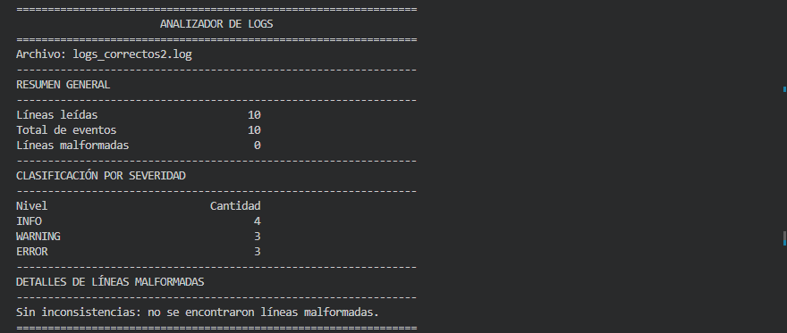
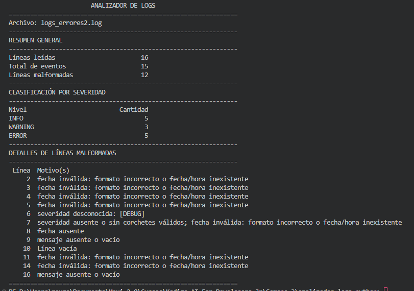
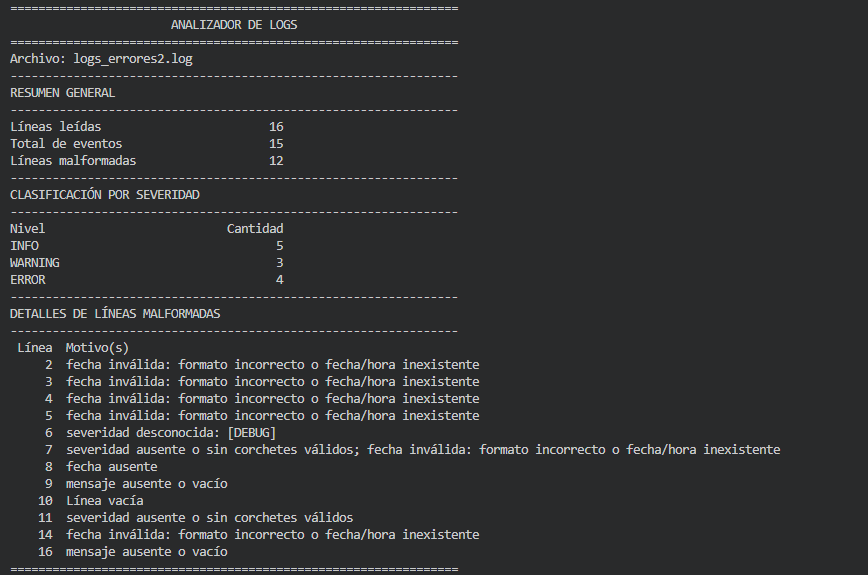

# Analizador de logs en Python

**Actividad individual: IA como herramienta, no como autor**  
**Módulo:** IA-first mindset
**Alumno:** Max Gabriel Sánchez Flores
**Coach:** Ronald Mejía

## 1. Descripción y objetivo

Para esta actividad desarrollé un script que permite revisar archivos de registros (logs) de una aplicación, como prueba se utilizan ejemplos ficticios relacionados con autenticación de usuarios y funcionamiento de servicios.

El programa lee un archivo de texto, reconoce los niveles `INFO`, `WARNING` y `ERROR`, comprueba las fechas y señala las líneas incompletas o mal formateadas. Al terminar, muestra un resumen organizado en la consola y cuando encuentra inconsistencias indica el número de línea y el motivo.

Trabajé con **Python y Codex en VS Code**, sin dependencias externas para el análisis.

## 2. Archivos incluidos

| Archivo o carpeta | Contenido |
| --- | --- |
| `analizador.py` | Script principal para leer, clasificar y resumir los registros. |
| `test_analizador.py` | Pruebas automatizadas con `unittest`. |
| `logs_correctos.txt` | Primer archivo de prueba: cinco registros correctos. |
| `logs_errores.txt` | Segundo archivo: registros con errores de formato o información incompleta. |
| `logs_correctos2.log` | Prueba adicional con fechas, horas, espacios y mensajes menos comunes. |
| `logs_errores2.log` | Prueba adicional con entradas que buscaban encontrar fallos en el análisis. |
| `evidencias/` | Capturas de los resultados antes y después de una corrección. |

## 3. Ejecución del programa

Se recomienda **Python 3.12**. No es necesario instalar paquetes con `pip`.

Desde una terminal ubicada en la carpeta del proyecto:

**Windows**

```powershell
python analizador.py logs_correctos.txt
python analizador.py logs_errores2.log
```

**Linux**

```bash
python3 analizador.py logs_correctos.txt
python3 analizador.py logs_errores2.log
```

También puede ejecutarse sin indicar un archivo:

```bash
python3 analizador.py
```

En ese caso intenta abrir un selector gráfico que muestra archivos `.txt` y `.log`, además de la opción de mostrat todos los tipos de archivo. Si `tkinter` o el entorno gráfico no están disponibles, permite ingresar la ruta por consola. Cuando la ruta se proporciona directamente como argumento, no necesita abrir ventanas, lo cual resulta útil para pruebas automatizadas.

La extensión `.log` no implica un formato diferente: el programa trabaja con **texto plano en UTF-8** que siga las reglas definidas. No interpreta directamente registros binarios como `.evtx` ni todos los formatos utilizados por aplicaciones reales.

## 4. Decisiones de validación tomadas antes de aceptar el resultado

Para mantener un criterio definido, trabajé con estas reglas:

1. Solamente se reconocen `INFO`, `WARNING` y `ERROR`, escritos entre corchetes **al inicio del registro**, permitiendo espacios anteriores.
2. La fecha puede tener el formato `AAAA-MM-DD` o `AAAA-MM-DD HH:MM:SS` y debe existir realmente en el calendario.
3. Una severidad reconocida se contabiliza aunque la fecha o el mensaje tengan un problema. La línea también se reporta como malformada.
4. Una línea vacía cuenta como malformada, pero no representa un evento. El total de eventos corresponde a las líneas no vacías.
5. Una severidad desconocida, por ejemplo `[DEBUG]`, se reporta sin aumentar los contadores de las tres severidades admitidas.
6. Una línea con varios problemas se cuenta una sola vez como malformada, aunque se indiquen distintos motivos.
7. Los datos ausentes no se completan ni se corrigen automáticamente.

Decidí conservar la severidad cuando pudiera reconocerse porque un registro incompleto todavía puede aportar información. Por esa misma razón, la suma de INFO, WARNING y ERROR no siempre será igual al total de eventos.

## 5. Evidencia de pruebas

Primero probé el programa con dos archivos: uno correcto y otro con errores frecuentes. Después incorporé dos archivos `.log` con casos menos comunes para observar si el script seguía las mismas reglas ante entradas más exigentes.

| Archivo | Líneas | Eventos | INFO | WARNING | ERROR | Malformadas |
| --- | ---: | ---: | ---: | ---: | ---: | ---: |
| `logs_correctos.txt` | 5 | 5 | 3 | 1 | 1 | 0 |
| `logs_errores.txt` | 10 | 9 | 3 | 2 | 2 | 7 |
| `logs_correctos2.log` | 10 | 10 | 4 | 3 | 3 | 0 |
| `logs_errores2.log` | 16 | 15 | 5 | 3 | **4** | 12 |

Los cuatro resultados de esta tabla coinciden con las ejecuciones registradas por Codex después de la última corrección. También comprobé en mi consola de Windows los dos archivos adicionales, las capturas se presentan a continuación.

**Archivo adicional sin inconsistencias:**



### Problema detectado y corrección

En una primera ejecución de `logs_errores2.log`, el programa contó **5 eventos ERROR** cuando esperaba **4**, aunque identificó correctamente las **12 líneas malformadas**. La diferencia se relacionaba con la línea 11:

```text
2025-06-10 El usuario escribió [ERROR] en un comentario
```

Ese texto contiene `[ERROR]`, pero no al comienzo como severidad. La primera implementación utilizaba `PATRON_SEVERIDAD.search(texto)`, que busca una coincidencia en cualquier parte de la línea y, por eso, aumentaba el contador incorrectamente.

**Antes de corregirlo:**



Le solicité a Codex revisar el caso sin cambiar mis archivos de prueba ni las reglas de validación. La corrección sustituyó esa búsqueda por `match()` sobre el texto sin espacios exteriores, para reconocer la etiqueta únicamente al comienzo de la línea.

**Después de corregirlo:**



Al repetir la prueba, se obtuvieron **4 eventos ERROR** y se conservaron las **12 líneas malformadas**. Para este caso la IA siempre necesitó revisión humana para cumplir el comportamiento esperado.

### Pruebas automatizadas y límites

El historial registra **23 pruebas automatizadas aprobadas** en la última revisión. Entre los casos revisados se incluyeron fechas inexistentes, años bisiestos, mensajes vacíos, severidades desconocidas, rutas con espacios, archivos inexistentes y ejecución sin depender de `tkinter` cuando la ruta se indica como argumento.

Para repetir esas pruebas:

```bash
python3 -m unittest -v
```

En Windows también puede ejecutarse `python -m unittest -v`.

**Límite de la comprobación:** el diálogo gráfico y algunos casos de ausencia de `tkinter` se evaluaron mediante simulaciones en el entorno de desarrollo de Codex. La ejecución por consola se comprobó en mi sistema operativo que es Windows.

## 6. Uso de IA y responsabilidades

Codex apoyó la implementación de funciones para leer los archivos, separar los campos, validar fechas, clasificar los eventos y mostrar el resumen. También generó pruebas automatizadas e incorporó un selector opcional mediante `tkinter.filedialog`.

Mi participación consistió en definir qué debía considerarse válido, preparar los archivos de prueba, revisar los resultados y señalar las diferencias que necesitaban una corrección. La IA también interpretó inicialmente un orden de campos distinto: esperaba `fecha [NIVEL] mensaje`, mientras mis ejemplos utilizaban `[NIVEL] fecha mensaje`. Fue necesario ajustar el código a los archivos reales, en lugar de cambiar los datos para que coincidieran con la implementación.

Para la interfaz decidí conservar un script de consola y añadir solamente una forma cómoda de elegir archivos. También mantuve la ejecución mediante argumentos para el caso de evaluar logs sin necesidad de abrir una ventana.

## 7. Reflexión técnica

El mayor aprendizaje en este caso sería que antes de pedirle a una IA que escriba código necesito definir cómo espero que responda el programa. En este ejercicio primero tuve que establecer las reglas para clasificar los registros y para determinar cuáles serían considerados malformados. Por ejemplo decidir que una fecha incorrecta no debía impedir que se contara el nivel de severidad cuando estuviera bien identificado. Esa decisión no dependía de cómo Codex quisiera implementar la función, sino del comportamiento que necesitaba comprobar.

La IA me ayudó principalmente con la estructura del script y con partes de Python que todavía no domino. Entre ellas están el uso de expresiones regulares para reconocer patrones, `datetime` para revisar las fechas y las funciones que recorren las líneas del archivo. También propuso pruebas automáticas y una manera de seleccionar archivos sin escribir siempre la ruta y gracias a las explicaciones que me entregó la IA, pude identificar para qué sirve cada bloque principal.

Uno de los problemas que surgieron fue que Codex asumió inicialmente que la fecha aparecía antes del nivel de severidad. Cuando los archivos estuvieron guardados y se ejecutaron, esa interpretación no coincidió con los ejemplos que había preparado. Más adelante apareció un problema menos evidente: en el archivo `logs_errores2.log`, una etiqueta `[ERROR]` dentro de un comentario se contabilizaba como severidad. El script se ejecutaba sin mostrar una excepción, pero producía un resultado incorrecto, preparar un archivo con casos menos comunes permitió detectar esa diferencia.

Al comparar el resultado obtenido con el esperado, identifiqué qué línea provocaba el problema y solicité una corrección localizada. Codex verificó que `search()` encontraba la etiqueta en cualquier posición y la sustituyó por `match()` para reconocerla solamente al inicio. Después de repetir la prueba, el contador pasó de cinco a cuatro eventos ERROR sin modificar el archivo utilizado.

En mi caso, una ventaja de trabajar con IA fue avanzar en la implementación sin tener que conocer de antemano cada detalle de Python. La limitación fue que algunas respuestas parecían funcionar, pero necesitaban comprobarse con datos que no fueran únicamente los ejemplos más sencillos. Por eso considero necesario primero entender para qué se utiliza cada función, establecer las reglas y revisar los resultados antes de aceptar el programa.

## 8. Alcance del ejercicio

El analizador está pensado para un formato sencillo de logs y no busca admitir todas las variantes reales. El proyecto no incluye interfaz gráfica completa, bases de datos ni dependencias de terceros. La idea fue mantener una solución pequeña, que se pueda ejecutar y explicar, y utilizar las pruebas para detectar una limitación real antes de entregar el código.